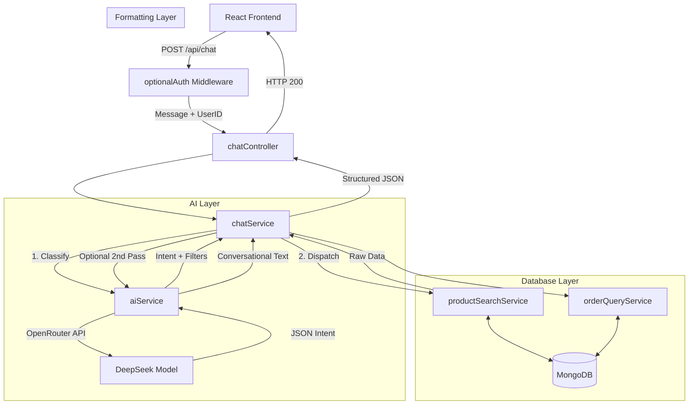

# Trendies AI Fashion Assistant Architecture

This document explains the entire logic, architecture, and reasoning behind the AI Fashion Assistant integrated into the Trendies e-commerce platform.

## 1. Why This Architecture? (The "Why")

When building an AI chatbot for e-commerce, the biggest risk is **AI Hallucination**—the AI making up products that don't exist, inventing fake prices, or giving incorrect order statuses. 

To solve this, we used the **Orchestrator Pattern** combined with **Retrieval-Augmented Generation (RAG)** principles:
- **MongoDB is the absolute source of truth.** The AI is never allowed to fetch data from its own pre-trained memory.
- **The AI acts as a Router and a Translator.** It translates human language into database filters (Intent Classification), and it translates database results back into human language (Natural Language Generation).
- **Separation of Concerns:** Controllers handle HTTP requests, the Orchestrator routes logic, AI services talk to LLMs (OpenRouter/DeepSeek), and Database services talk to MongoDB.

## 2. TL;DR: The Core Flow (How it actually works)
At its simplest, the entire process follows these 6 steps:

1. **User Prompt** ➡️ goes to `chatService.js` (The Orchestrator)
2. **`chatService.js`** ➡️ sends prompt to `aiService.js`
3. **`aiService.js`** ➡️ identifies the intent and filters, and returns them as strict JSON (acting only as a data extractor).
4. **`chatService.js`** ➡️ receives this JSON and applies the exact MongoDB query based on the intent.
5. **MongoDB** ➡️ returns real, factual data from the database.
6. **`chatService.js`** ➡️ prepares the final answer using this real data and sends it back to the user.

---

## 3. Request-Response Flow (Detailed Breakdown)

Here is the step-by-step lifecycle of a single user message:

### Step 1: The User Interface (Frontend)
1. The user types a message (e.g., *"Show me winter hoodies under ₹1000"*) in the React `Chatbot.jsx` component.
2. The frontend sends a `POST` request to `/api/chat` via Axios, passing the user's message and credentials (cookies).

### Step 2: Controller & Authentication (Backend)
1. **Middleware (`optionalAuth.js`)**: Intercepts the request. If the user is logged in (has a valid JWT), it attaches their `userId` to the request. If not, it allows them to proceed as a "Guest".
2. **Controller (`chatController.js`)**: Validates the input to ensure it's not empty, then passes the message and `userId` to the Orchestrator (`chatService.js`).

### Step 3: Intent Classification (The Orchestrator & AI Service)
1. **Orchestrator (`chatService.js`)** sends the raw message to `aiService.classifyIntent(message)`.
2. **AI Service (`aiService.js`)** sends a structured prompt to the AI Model (OpenRouter/DeepSeek).
3. **The AI's Job:** The AI analyzes the text and responds with strict JSON containing an `intent` and extracted `filters`.
   *Example AI Output:*
   ```json
   {
     "intent": "PRODUCT_SEARCH",
     "filters": { "subCategory": "hoodies", "maxPrice": 1000, "query": "winter" }
   }
   ```
4. The parsed JSON is returned to the Orchestrator.

### Step 4: Dispatching the Intent
The Orchestrator (`chatService.js`) uses a `switch` statement based on the classified `intent`. There are 8 core intents:

1. **`PRODUCT_SEARCH`**: 
   - Calls `productSearchService.searchProducts(filters)`.
   - Queries MongoDB using `$regex` (for `name` and `description`) and specific filters (price, category).
   - Returns the exact product documents. (No second AI call is made here for speed).

2. **`PRODUCT_INFO`**: 
   - Retrieves specific product details from the database.
   - Passes the raw data to the AI to format a polite, conversational answer.

3. **`PRODUCT_RECOMMENDATION`**: 
   - Queries MongoDB to find products matching the filters.
   - Sends those exact products to the AI to generate personalized fashion advice based *only* on the provided products.

4. **`FASHION_ADVICE`**: 
   - A direct call to the AI to provide general style tips (e.g., *"What colors match with olive green?"*). No database query needed.

5. **`ORDER_STATUS` & `ORDER_HISTORY`**: 
   - Checks if `userId` exists. If not, asks the user to log in.
   - If logged in, calls `orderQueryService.js` to fetch the user's orders from MongoDB and formats the response programmatically.

6. **`STORE_INFO`**: 
   - Returns static text for shipping policies, return policies, etc.

7. **`OUT_OF_SCOPE` / `SYSTEM_ERROR`**: 
   - Handles irrelevant questions (e.g., *"Who is the president?"*) or API failures gracefully.

### Step 5: Returning the Response
1. The Orchestrator packages the result into a standard format:
   ```json
   {
     "success": true,
     "intent": "PRODUCT_SEARCH",
     "message": "Here are some products I found for you!",
     "products": [{...}, {...}] 
   }
   ```
2. The Controller sends this JSON back to the React frontend with an HTTP 200 status.
3. **UI Rendering**: The React component displays the `message` in a chat bubble. If `products` are present, it renders them as horizontal scrollable cards.

---

## 4. Architecture Diagram



## 5. Key Technical Decisions
- **Two-Pass vs. One-Pass**: Standard searches (`PRODUCT_SEARCH`) only use one AI call (for classification) and format the response programmatically. This saves massive API costs and reduces latency. Only complex queries (`PRODUCT_RECOMMENDATION`) use a second AI call to formulate an answer.
- **OpenRouter & OpenAI SDK**: We use the official `openai` Node package but point the `baseURL` to OpenRouter. This gives access to powerful, cost-effective models like DeepSeek, while maintaining a standardized codebase.
- **Fail-Safes**: If the AI goes down or the API key runs out of quota, the system catches the error in `chatService.js` and returns a `SYSTEM_ERROR` intent, showing a polite "try again later" message instead of crashing the backend.
