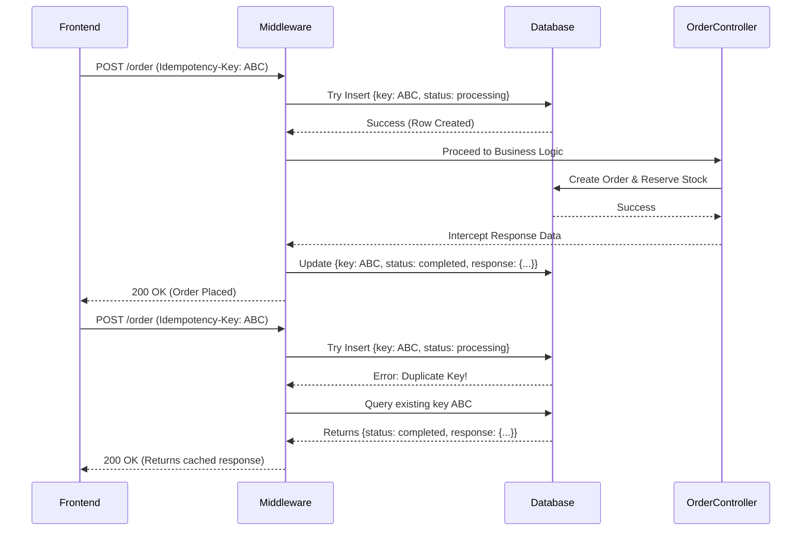

# How Idempotency Works: The Exact Logic

This document explains the exact step-by-step logic of how an Idempotency Key system works, and how it strictly guarantees that your database state only changes once, no matter how many duplicate requests arrive.

## The Core Concept: The Database is the Source of Truth
To guarantee the database state doesn't change twice, we rely on a core feature of MongoDB (and all databases): **Unique Indexes**. We create an `Idempotency` collection where the `key` field must be strictly unique. This uniqueness acts as an atomic lock.

Here is the exact lifecycle of a request:

### Step 1: The Client Generates the Key
**When exactly should you generate this key?**
This is a critical part of the process. If you generate it at the wrong time, you might break the user experience.

1. **When to Generate:** You should generate the UUID (`uuidv4()`) the moment the user reaches the "Checkout" or "Place Order" page, OR right when the cart data changes. Store this key in your React state (e.g., `const [idempotencyKey, setIdempotencyKey] = useState(uuidv4())`).
2. **When to SEND it:** Send this exact key in the headers (`Idempotency-Key`) every single time the user clicks the "Place Order" button. 
3. **When NOT to regenerate:** **DO NOT** generate a new key inside the `onClick` handler of the "Place Order" button. If you generate a new key on every click, the backend will treat every click as a brand new unique request, entirely defeating the purpose of idempotency!
4. **When to RE-generate:** You only generate a *new* key when the user's intended action actually changes. For example, if they leave the checkout page, change the items in their cart, and return to checkout—that is a new intended order, so it needs a new key.

When the user clicks "Place Order", the frontend sends the request with the header: `Idempotency-Key: 123e4567-e89b-12d3...`

### Step 2: The Initial Request Arrives (Attempt 1)
1. Your backend middleware receives the request and extracts the `Idempotency-Key`.
2. It attempts to create a new document in the `Idempotency` database collection: `{ key: "123...", status: "processing" }`.
3. Because this is the first time we've seen this key, the database saves it successfully.
4. The middleware allows the request to proceed to your `orderController.js`.
5. Your controller reserves the stock, creates the order, and generates the final JSON response.
6. Right before sending the response to the user, the middleware intercepts it. It updates the database record to `{ key: "123...", status: "completed", response: {...} }`.
7. The user receives the success response.

### Step 3: The Duplicate Request Arrives (Attempt 2)
Let's say the user double-clicked, or their network dropped, causing a second identical request to be sent with the exact same `Idempotency-Key`.

1. The middleware receives the second request.
2. It attempts to create a new document in the `Idempotency` collection with the same key. 
3. **The Guarantee:** MongoDB immediately throws a `Duplicate Key Error` because the key already exists! This entirely prevents a race condition at the database level.
4. The middleware catches the error, realizing this is a duplicate request. 
5. It queries the database for the existing key. 
6. It sees the status is `"completed"`, grabs the saved `response` data, and sends it directly back to the user. 
7. **Result:** The request NEVER reaches your `orderController.js`. No new stock is reserved, no new order is saved. The database state remains completely untouched, but the frontend gets the exact response it needs.

### What if Attempt 2 arrives while Attempt 1 is still processing?
If the user clicks really fast, Attempt 2 might hit the server while Attempt 1 is still busy talking to Razorpay.
1. Attempt 2 hits the middleware.
2. It attempts to insert the key and gets the `Duplicate Key Error`.
3. It queries the database and sees `{ key: "123...", status: "processing" }`.
4. The middleware recognizes that Attempt 1 is currently handling this. It immediately returns an HTTP `409 Conflict` (or `429 Too Many Requests`) with a message like "Order is currently processing, please wait." 

## Visualizing the Logic

## Edge Cases: When Can UUID Idempotency Fail?

Even with a robust UUID approach, there are a few edge cases that can break the system if not handled correctly:

### 1. Payload Mutation (The "Ghost Cart" Bug)
**The Problem:** The user clicks "Place Order" for Item A. The UUID `123` is sent and processed. The user then goes back, adds Item B to their cart, and clicks "Place Order" again. But your frontend *forgets* to regenerate the UUID. It sends UUID `123` again but with a new payload (Item A + Item B). The backend sees UUID `123` and instantly returns the cached success response for Item A, completely ignoring Item B!
**The Fix:** The backend should hash the incoming `req.body` and store that hash alongside the key. If a request comes in with the same key but a *different* hash, the backend should reject it with a `400 Bad Request` ("Payload changed for existing idempotency key").

### 2. Server Crashes (The "Stuck Lock" Problem)
**The Problem:** A request comes in, and the database marks it as `{ status: "processing" }`. Before the backend can finish processing and update it to `"completed"`, your Node.js server crashes (e.g., out of memory or a restart). The key is now permanently stuck in the `"processing"` state. If the user retries, they will get a `409 Conflict` ("Order is currently processing") forever.
**The Fix:** Add a `startedAt` timestamp to the database row. If a request comes in and sees the key is `"processing"`, but the `startedAt` timestamp is older than 2 minutes, assume the previous server process died and allow the retry to take over the lock.

### 3. Expiration / Database Purging
**The Problem:** Idempotency keys are usually deleted after 24 hours to save database space (using MongoDB TTL indexes). If a rogue automated script or delayed network request retries the exact same checkout 48 hours later, the backend will treat it as a brand new request because the key was deleted.
**The Fix:** Ensure your TTL (Time-To-Live) is reasonably long (e.g., 7 to 30 days for financial transactions) so that late retries are caught.

### 4. Cross-User UUID Collisions (Extremely Rare)
**The Problem:** Two different users randomly generate the exact same `uuidv4()` at the same time. The second user gets the cached order response of the first user.
**The Fix:** While `uuidv4()` collisions are mathematically near-impossible, you can make it 100% impossible by prefixing the idempotency key with the User ID: `user_XYZ_uuidv4`.
