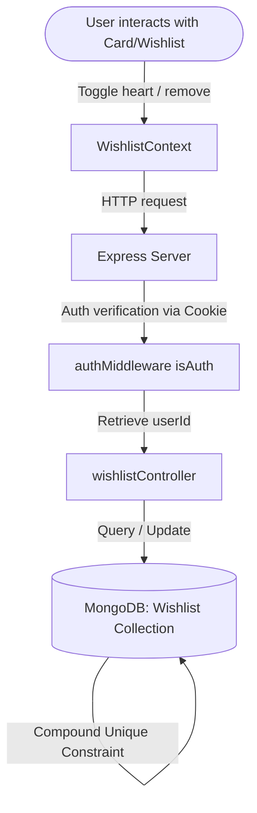

# Trendies E-Commerce — Feature Implementation Guide

This document explains the design, logic, and code changes implemented for the Wishlist System, Active Filter Chips, Price Filter, Product Count, and Card Hover Effects.

---

## 1. Feature 1: Wishlist System

### Architecture & Data flow
The wishlist system uses a standard MongoDB collection. Each wishlist item maps a `userId` to a `productId`.
To prevent duplicates, a compound index `{ userId: 1, productId: 1 }` is applied with a `unique: true` constraint at the database layer.



### Backend Changes

#### A. Mongoose Schema (`backend/model/wishlistModel.js`)
* **Logic**: We define a separate schema rather than storing wishlist arrays in the `Product` or `User` document. This scales better and keeps models decpoupled.
* **Code**:
```javascript
const mongoose = require("mongoose");

const wishlistSchema = new mongoose.Schema({
    userId: {
        type: mongoose.Schema.Types.ObjectId,
        ref: "User",
        required: true
    },
    productId: {
        type: mongoose.Schema.Types.ObjectId,
        ref: "Product",
        required: true
    }
}, { timestamps: true });

// Prevent duplicate wishlist entries for same user and product
wishlistSchema.index({ userId: 1, productId: 1 }, { unique: true });

module.exports = mongoose.model("Wishlist", wishlistSchema);
```

#### B. API Controllers (`backend/controller/wishlistController.js`)
* **Logic**: Handles toggling (adds if missing, removes if exists) and fetching the active wishlist.
* **Code**:
```javascript
const Wishlist = require("../model/wishlistModel");

// POST /api/wishlist/toggle
exports.toggleWishlist = async (req, res) => {
    const { productId } = req.body;
    const userId = req.userId; // Provided by authMiddleware

    const existing = await Wishlist.findOne({ userId, productId });
    if (existing) {
        await Wishlist.findByIdAndDelete(existing._id);
        return res.status(200).json({ wishlisted: false });
    } else {
        await Wishlist.create({ userId, productId });
        return res.status(201).json({ wishlisted: true });
    }
};

// GET /api/wishlist
exports.getWishlist = async (req, res) => {
    const wishlistItems = await Wishlist.find({ userId: req.userId }).select("productId -_id");
    res.status(200).json({ productIds: wishlistItems.map(item => item.productId) });
};
```

---

### Frontend Changes

#### A. Context State (`frontend/src/context/WishlistContext.jsx`)
* **Logic**: We store the user's wishlisted product IDs inside a Javascript `Set` instead of an array. Checking `wishlistIds.has(id)` runs in **O(1) constant time**, keeping UI re-renders extremely fast when scrolling the catalog.

```javascript
import React, { createContext, useState, useEffect } from "react";
import axios from "axios";

export const wishlistDataContext = createContext();

export const WishlistProvider = ({ children }) => {
  const [wishlistIds, setWishlistIds] = useState(new Set());

  const fetchWishlist = async () => {
    const res = await axios.get("/api/wishlist");
    setWishlistIds(new Set(res.data.productIds));
  };

  const toggleWishlist = async (productId) => {
    const res = await axios.post("/api/wishlist/toggle", { productId });
    setWishlistIds(prev => {
      const updated = new Set(prev);
      res.data.wishlisted ? updated.add(productId) : updated.delete(productId);
      return updated;
    });
  };

  return (
    <wishlistDataContext.Provider value={{ wishlistIds, toggleWishlist, fetchWishlist }}>
      {children}
    </wishlistDataContext.Provider>
  );
};
```

#### B. Component Comparison: `Card.jsx`
* **Logic**: We add a heart overlay icon. We must call `e.stopPropagation()` when the heart is clicked so the browser does not trigger the card wrapper's `onClick` navigation to the ProductDetail page. We also check `userData` and alert non-logged-in users.

| Previous Code | New Modified Code |
| :--- | :--- |
| ```javascript
const Card = ({ name, image, price, id }) => {
  const { currency } = useContext(shopDataContext);
  const navigate = useNavigate();
  return (
    <div className='w-full bg-[#ffffff0a] ...' 
         onClick={()=>navigate(`/productdetail/${id}`)}>
      <div className='w-full h-64 bg-white rounded-sm overflow-hidden'>
        
      </div>

      <div className='mt-3 text-[#c3f6fa] text-[18px] truncate'>{name}</div>
      <div className='text-[#f3fafa] text-[14px] mt-1'>{currency}{price}</div>
    </div>
  )
}
``` | ```javascript
const Card = ({ name, image, price, id }) => {
  const { currency } = useContext(shopDataContext);
  const { isWishlisted, toggleWishlist } = useContext(wishlistDataContext);
  const { userData } = useContext(userDataContext);
  const navigate = useNavigate();

  const handleWishlistClick = async (e) => {
    e.stopPropagation(); // Avoid triggering card navigation
    if (!userData) {
      toast.info("Please login to use wishlist");
      navigate("/login");
      return;
    }
    await toggleWishlist(id);
  };

  return (
    <div className='w-full bg-[#ffffff0a] ...' onClick={()=>navigate(`/productdetail/${id}`)}>
      <div className='w-full h-64 bg-white rounded-sm overflow-hidden relative group'>
        
        
        {/* Wishlist Heart Overlay */}
        <button onClick={handleWishlistClick} className='absolute top-2 right-2 ...'>
          {isWishlisted(id) ? (
            <FaHeart className='text-red-500' />
          ) : (
            <FaRegHeart className='text-white' />
          )}
        </button>
      </div>
      ...
    </div>
  )
}
``` |

---

## 2. Feature 2: Active Filter Chips

### Logic & Synchronization
* **Problem**: Previously, filter check states were uncontrolled, making it difficult to update checkboxes from outside (such as when clicking the `✕` on a filter chip).
* **Solution**: We convert checkboxes inside `Collection.jsx` to **controlled components** using the `checked` property. When a chip is removed, the state array changes, which automatically clears the checkbox.

```
State: category = ["Men"]
Checkbox (Men) -> checked={category.includes("Men")} -> Checked
Click Chip 'Men' [x] -> removes "Men" from category state
State updates: category = []
Checkbox (Men) -> checked={category.includes("Men")} -> Unchecked
```

### Component Comparison: `Collection.jsx` (Filter Sidebar Checkboxes)

| Previous Code (Uncontrolled) | New Modified Code (Controlled) |
| :--- | :--- |
| ```javascript
<div className='flex flex-col gap-2'>
  <label className='flex items-center gap-2'>
    <input type='checkbox' 
           value='Men' 
           onChange={toggleCategory} 
           className='w-4 h-4' /> 
    Men
  </label>
  ...
</div>
``` | ```javascript
<div className='flex flex-col gap-2'>
  {['Men', 'Women', 'Kids'].map((cat) => (
    <label key={cat} className='flex items-center gap-2 cursor-pointer'>
      <input type='checkbox'
             value={cat}
             checked={category.includes(cat)} // Controlled check state
             onChange={() => toggleCategory(cat)}
             className='w-4 h-4' />
      {cat}
    </label>
  ))}
</div>
``` |

---

## 3. Feature 3: Price Filter

### Logic & OR filtering
* **Logic**: We define constant objects matching the required ranges. When filters are evaluated, category/subcategory and price ranges are combined. Within categories/subcategories/price groups, an item matches if it fits **any** of the selected keys within that category (OR logic). Between different filter groups, the product must satisfy **all** selected filter groups (AND logic).

```javascript
const PRICE_RANGES = [
  { key: '0-50', label: '₹0 - ₹50', min: 0, max: 50 },
  { key: '50-100', label: '₹50 - ₹100', min: 50, max: 100 },
  { key: '100-200', label: '₹100 - ₹200', min: 100, max: 200 },
  { key: '200+', label: '₹200+', min: 200, max: Infinity },
];
```

### Filtering implementation inside `applyFilter()`:

| Previous Code | New Modified Code |
| :--- | :--- |
| ```javascript
const applyFilter = () => {
  let productCopy = products.slice();

  // Search filter...
  // Category filter...
  // Subcategory filter...

  // Sorting logic...
  setFilterProduct(productCopy);
};
``` | ```javascript
const applyFilter = () => {
  let productCopy = products.slice();

  // Search filter...
  // Category filter...
  // Subcategory filter...

  // New Price Range Filter (OR logic within selected ranges)
  if (priceRanges.length > 0) {
    const selectedRanges = PRICE_RANGES.filter(r => priceRanges.includes(r.key));
    productCopy = productCopy.filter(item =>
      selectedRanges.some(range => item.price >= range.min && item.price < range.max)
    );
  }

  // Sorting logic...
  setFilterProduct(productCopy);
};
``` |

---

## 4. Feature 4: Product Count

### Logic
* **Logic**: Simple and reactive. The length of the filtered results (`filterProduct.length`) is displayed below the filter chips and above the grid. As soon as the `useEffect` recalculates the matching products, the layout instantly displays the correct number.

### Code
```jsx
{/* Product Count Display */}
<p className='text-gray-400 text-sm mb-4'>
  Showing <span className='text-amber-400 font-semibold'>{filterProduct.length}</span> Products
</p>
```

---

## 5. Feature 5: Product Card Hover Effects

### Logic & CSS Transitions
* **Logic**: Instead of using Tailwind utility hover transitions (which can sometimes lead to layout reflow delays), we implement inline transitions via JS events (`onMouseEnter`, `onMouseLeave`) to change styling variables directly, utilizing `translateY(-5px)` and a subtle glow shadow matching our brand's amber highlights.

### Code Comparison: `Card.jsx` Container Div

| Previous Code | New Modified Code |
| :--- | :--- |
| ```javascript
<div className='w-full bg-[#ffffff0a] backdrop-blur-lg rounded-lg hover:scale-[102%] transform transition duration-200 flex flex-col p-3 cursor-pointer border border-[#80808049]' onClick={()=>navigate(`/productdetail/${id}`)}>
  ...
</div>
``` | ```javascript
<div
  className='w-full bg-[#ffffff0a] backdrop-blur-lg rounded-lg flex flex-col p-3 cursor-pointer border border-[#80808049]'
  onClick={() => navigate(`/productdetail/${id}`)}
  style={{
    transition: 'transform 0.3s ease, box-shadow 0.3s ease',
  }}
  onMouseEnter={(e) => {
    e.currentTarget.style.transform = 'translateY(-5px)';
    e.currentTarget.style.boxShadow = '0 12px 28px rgba(245, 158, 11, 0.15), 0 4px 10px rgba(0,0,0,0.3)';
  }}
  onMouseLeave={(e) => {
    e.currentTarget.style.transform = 'translateY(0)';
    e.currentTarget.style.boxShadow = 'none';
  }}
>
  ...
</div>
``` |
